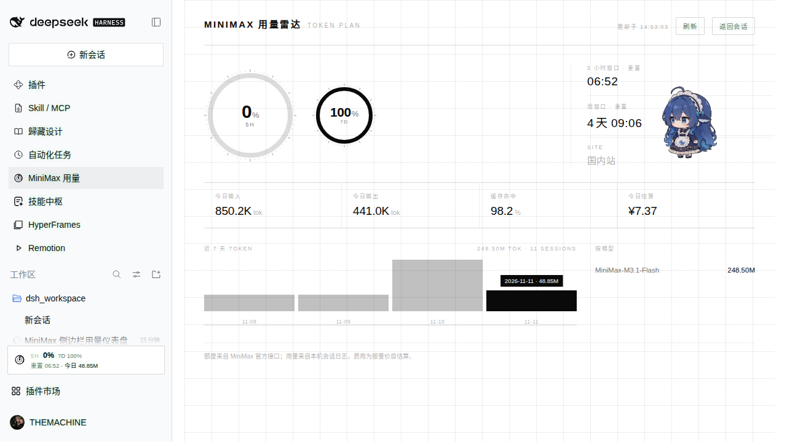
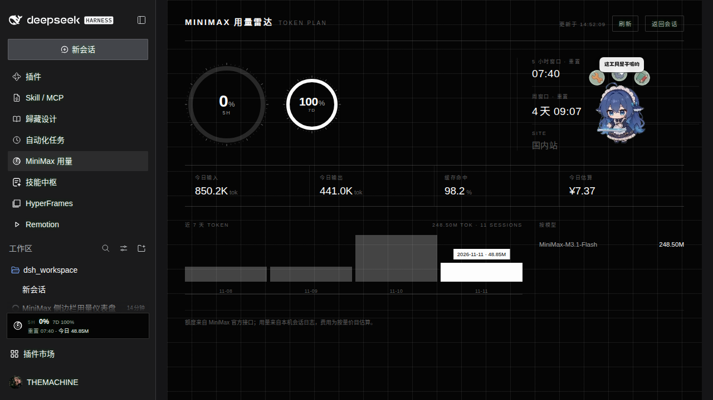

# MiniMax 用量雷达

侧边栏常驻读数 + 主面板仪表盘，盯 MiniMax **Token Plan** 的两个额度窗口（5 小时 / 周）、
两级重置倒计时，以及**本机**实际的 token 消耗与折算费用。

配色是「金白水黑」：严格无彩色，只有纯黑和纯白两级。墨色与底色随宿主明暗主题反相 ——
深色下白墨黑底，浅色下黑墨白底，像一块仪器面板而不是网页里的卡片。

## 安装

```sh
dsh plugin add github:themachinecorp/dsh-minimax-radar
```

装完重启一次 dsh web（新增 bundle 需要重建插件图），然后刷新页面。
额度查询复用 dsh 设置里已配置的 MiniMax 订阅 Key，不需要额外填。

## 截图





## 低额度告警

任一时间窗口余量低于 **10%** 时自动进入告警态，仍然只用黑白两级、不引入任何颜色：

- 环形轨道改为虚线圈（余量为 0 时没有弧可看，只有轨道能传达状态）
- 中心百分比反白成实心块（黑底白字 / 白底黑字，随主题反相）
- 标签追加 `· LOW`，侧边栏读数条同步反白数字

选反白而不是变红，是因为红/黄在深色主题下会和别的插件抢注意力，而黑白反白在任何主题下都是同一个意思。

## 装了什么

| 落点 | 内容 |
|---|---|
| `sidebar.panellist` | 左侧栏的雷达图标，点开主面板 |
| `sidebar.footer.action` | 侧边栏底部的常驻读数条：5H 余量 + 重置倒计时 + 今日 token |
| `main` | 完整仪表盘：双环余量、重置倒计时、今日输入/输出/缓存命中/估算费用、近 7 天柱状图、按模型汇总 |

## 数据从哪来

**额度**：MiniMax 官方 Token Plan 接口 `GET /v1/token_plan/remains`
（国内站 `api.minimaxi.com`，国际站 `www.minimax.io`）。给出每个模型行的
`current_interval_remaining_percent`（5 小时窗口）与 `current_weekly_remaining_percent`
（周窗口），以及 `end_time` / `weekly_end_time` —— 后者就是重置时刻，倒计时据此在本地每秒重算。

**本机用量**：dsh 的 `sessionPersistence` 服务，读全部会话的 `assistant/message` 事件里
`data.usage` 的 token 计数，按 `data.message.source.provider` 过滤出 MiniMax 的调用，
以事件时间归入本地日。fork 出来的会话按 `inheritedEventCount` 截掉继承段，不重复计父会话。

**费用**：按量后付费标准档价目（元 / 百万 tokens）。当前表里只有 `minimax-m3.1-flash`
= 输入 1.00 / 输出 4.00 / 缓存读取 0.10。没有公开单价的模型**不计价**，不猜。

> 订阅额度（百分比）和本机 token 花费（绝对值）是两套口径：前者是套餐窗口剩余，
> 后者是这些调用如果按量后付费会花多少钱。两个都看才有意义。

## 密钥

复用 dsh 设置里已配置的订阅 Key：`MINIMAX_CN_API_KEY`（国内站）/ `MINIMAX_API_KEY`（国际站）。
先查 `ctx.credentials`，再回落到进程环境变量。Key 只在 Host 进程里用，不出浏览器 ——
浏览器只拿到聚合后的数字。

普通按量付费 API Key 不能查 Token Plan 额度，接口会拒绝，面板会显示提示。

## 接口

Host 侧一条只读路由：

```
GET /api/minimax-radar/state[?force=1]
```

走 dsh 自己的 `/api` 信任栅栏（`ctx.connection.requestRejection`）：回环、监听地址、
`trustedHosts` + 浏览器会话，与宿主其余 `/api` 调用同一套放行规则。响应里的
`usage.sessions` / `usage.events` 是扫描面，便于判断数据是不是新鲜的。

Host 侧缓存：额度 45 秒、本机用量 60 秒；`?force=1` 跳过缓存（面板的「刷新」按钮）。
客户端每 30 秒轮询一次，倒计时在本地每秒重算，不额外打接口。

## 构建

`client.js` 是构建产物，由 `src/client.jsx` 经 esbuild 生成：

```bash
npx esbuild src/client.jsx --jsx-factory=React.createElement \
  --jsx-fragment=React.Fragment --target=es2020 --outfile=client.js
```

没有运行时依赖：Host 半不 import 任何 `@deepseek-ai/*`，服务一律 `ctx.get(...)` 取；
Client 半只用 `require('react')` 与宿主模块表里的东西。

## 已知边界

- 只统计**本机**会话日志，别的机器上跑的用量看不到。
- 缓存写入（`cacheWriteTokens`）在价目表里没有单列，保守按输入档计。
- `remains_time` 的语义以 MiniMax 控制台为准；面板只做百分比的忠实展示，不在本地「修正」扣费。
- 官方的 `current_interval_total_count` 当前恒为 0，所以只能给百分比，给不出绝对余量。
